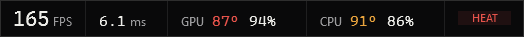
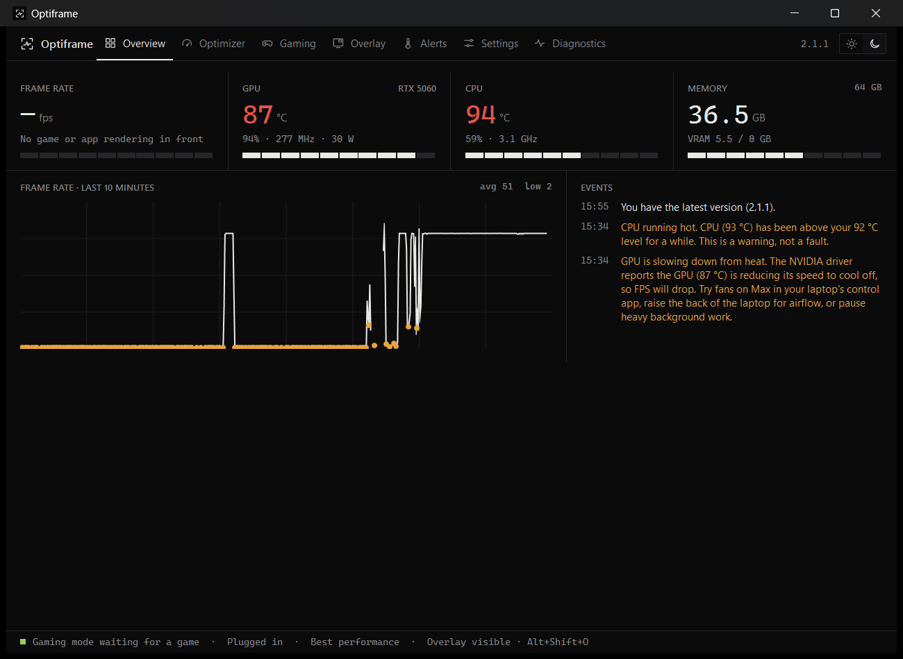

# Optiframe

A lightweight performance overlay and optimizer for Windows. It shows your frame rate, frame times and
what your GPU and CPU are doing, in a quiet line over any game. It can also tune a few Windows
settings while you play, and it puts every one of them back afterwards.



**[Download the latest release](https://github.com/Kaeden-Martinson/Optiframe/releases/latest)**: run
`Optiframe-Setup-<version>.exe`. It installs for your account only and needs no administrator rights.

## What it does

- **In-game overlay.** Live FPS, frame time and 1% lows for DirectX, Vulkan, OpenGL and browser games,
  plus GPU and CPU temperature, load, clock and power. It comes in two layouts:
  - **Strip:** one steady line that doesn't change width as numbers change.
  - **Panel:** adds a live frame-time trace.

  Drag it anywhere on any screen and pin it. Clicks pass through to your game.
- **Slowdown warnings.** When the driver or Windows reports the hardware slowing itself down from heat or
  power limits, the overlay says so. Readings turn amber at your warning level and red at your hot level.
- **Automatic gaming mode.** While a game from your list is in front, it can:
  - switch Windows to Best performance;
  - raise the game one priority step and lower apps you choose one step.

  When you stop playing, everything goes back.
- **Optimizer.** The Windows settings that matter for games, each with its current value, the recommendation
  and the drawback. Nothing changes until you press a button.
- **Diagnostics.** What works on this PC, plus every Windows setting the app currently has changed, with
  Undo for each.
- **Light and dark.** Follows Windows, or pick one.



## Changes you can always undo

Before Optiframe changes a Windows setting, it records the original value. It puts the setting back only
if it still holds what the app set. If you changed it yourself in the meantime, your choice is kept. If
the app is closed or crashes mid-game, the next start puts back what gaming mode changed. It never
touches Windows system processes, never asks for or stores an administrator password, and sends
nothing anywhere. The only network request is the update check against this repository's releases.

## Requirements

- Windows 10 or 11, 64-bit.
- The [.NET 8 Desktop Runtime](https://dotnet.microsoft.com/download/dotnet/8.0). Windows offers to install
  it on first start if it's missing.
- **For FPS on a standard account:** membership in the Windows group *Performance Log Users*, because
  Windows only lets that group and administrators read the frame events. An administrator adds you once,
  then you sign out and back in. Everything else works without it.
- GPU readings need an NVIDIA GPU. Other GPUs still get FPS and CPU readings.

## Updating and uninstalling

Optiframe checks this repository for new releases once a day, or when you press **Settings › Check now**.
**Download and install** verifies the file's SHA-256 against the release notes before anything runs. Your
settings carry over, and the previous version is kept as a fallback.

To remove it: **Settings › Apps › Optiframe › Uninstall**. You can choose to undo the Windows changes the
app made and to delete your settings.

Optiframe isn't code-signed, so Windows SmartScreen may warn the first time you run the setup.

## More

- [Full guide](PCSpecOverlay/README.md): every page, what each number means and where it comes from,
  gaming-mode safety rules, files and troubleshooting.
- [Releases](https://github.com/Kaeden-Martinson/Optiframe/releases): what changed in each version.

## Building

```
dotnet build PCSpec.slnx -c Release
dotnet test PCSpec.slnx -c Release
.\build-release.ps1
```

`build-release.ps1` runs the tests, publishes the single-file setup to `artifacts\release`, and writes the
release notes with the SHA-256 line the updater needs. A copy you run from anywhere other than the install
folder is a development build, with its own settings and startup entry, so it never interferes with the
installed app.
